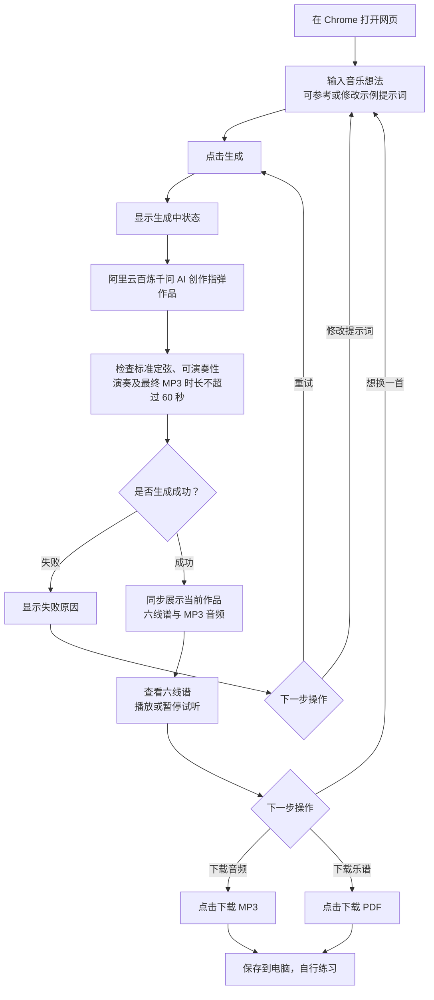

# 音乐伙伴三天原型功能流程图

更新日期：2026-10-09

依据：最新三天原型需求与功能清单。首次使用电脑端 Chrome，无需注册或水平测评。

## 流程说明

- 两个下载按钮独立使用，可以分别下载，也可以先后下载两类文件；不做 ZIP 打包。
- 作品采用标准定弦，仅支持简单和声加旋律，不含打板等打击类技巧。
- 难度主要参考 BPM；优先前五品，允许少量更高品位和十六分音符；保留基本可演奏性检查。
- 网页六线谱、试听 MP3、下载 MP3 与 PDF 对应同一作品版本。
- 修改提示词后重新生成整段作品，保留原 BPM 和调性；新结果完成后同步更新谱面与音频，不做局部生成。
- 生成成功包含对应音频与 PDF 已准备好；模型或检查失败时明确提示，不用纯模板结果冒充 AI 生成。
- 下载失败时明确提示，并允许重新下载当前作品；无需重新调用 AI。
- 本次不包含社区、账号、作品库、哼唱、练习评价与进度追踪；安卓打包属于后续方向。

## 最新参数确认（2026-10-09）

- AI 开发测试总预算不超过人民币 200 元。千问型号、账号地域和凭证在测试接入时确定；密钥仅放本机服务端配置。记录实际调用与重试消耗，预算检查在调用前执行；供应商实际计费也需核对，不把无统计的重试视为免费。
- 指型优先选择空弦及前五品，允许少量更高品位，并非严格限定第 0—5 品。更高品位上限和“少量”的具体判定尚未量化，不自行设定数字；仍需检查跨度、换把和同弦冲突，并人工审阅样例。
- 允许十六分音符，不因此默认启用未确认的复杂节奏或技巧。
- 难度主要参考 BPM：其他条件相近时，BPM 越低通常越容易，越高通常越难。这替代此前“音符密度为主要指标”的要求；首版不新增难度等级或水平选择界面，也不以音符密度计数口径作为开发前置条件。BPM 不能代替节奏与指型的可演奏性检查。
- 最终 MP3 文件总时长不得超过 60 秒，包括尾音和编码影响；生成时预留尾音空间，编码后检查实际文件时长。不通过截断尚未结束的音符满足上限。
- 整段重新生成保留当前展示作品的 BPM 和调性，只改变音乐内容；首次生成没有旧作品约束。前端提交当前作品编号，服务端读取旧作品并校验新结果的 BPM 和调性完全一致。失败保留旧作品，成功时谱面、MP3 和 PDF 同步替换；不要求保留原旋律主题。

剩余待确认：测试时选择千问型号/地域并配置凭证；高品位“少量”的上限或比例、可接受的按弦跨度及换把负担。BPM 难度分级阈值不属于当前无等级界面的必做功能。
