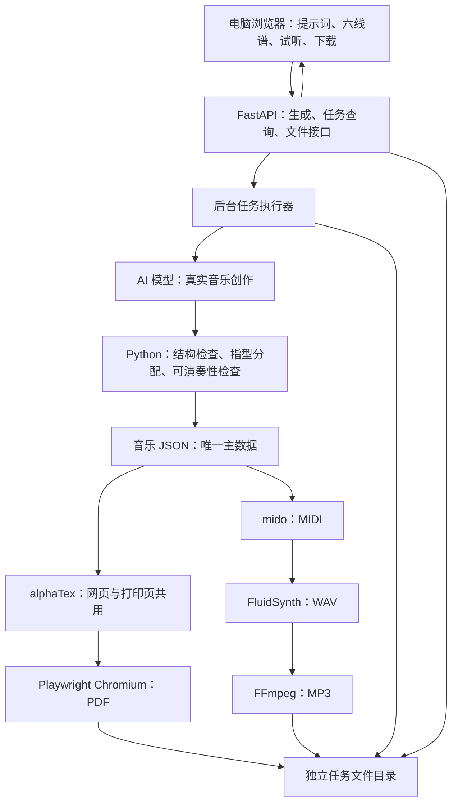

# 音乐伙伴三天原型方案 B 技术方案

更新日期：2026-10-09

状态：用户已选择方案 B，即 React/Vite 网页 + Python/FastAPI 后台。本文作为三天原型的当前技术方案，依据《音乐伙伴三天原型需求文档.md》；此前的多方案比较文档保留作参考，不再沿用其中优先方案 A 的建议。

AI 提示词生成音乐是必做功能。以下为实现设计，尚未编写原型、验证候选模型或测量工期；模型供应商已确认为阿里云百炼千问；具体型号及其余待定参数不自行指定。

## 1. 实现范围

- 仅吉他指弹，作品为简单和声加旋律。
- 标准定弦：六弦到一弦为 E2、A2、D3、G3、B3、E4；不支持打板等打击类技巧。
- 作品演奏时长不超过 60 秒，作品内部速度与调性统一。
- 用户以文字及示例提示词开始创作，由真实 AI 模型参与音乐内容创作。
- 网页展示有节奏信息的六线谱，播放与当前作品一致的 MP3。
- 支持整段重新生成，并下载 MP3 音频和 PDF 六线谱。
- 不要求账号或测评，不做哼唱、社区、局部编辑、作品库与练习追踪。
- 首次在电脑端 Chrome 浏览器演示，安卓打包放到后续阶段。
- MP3 与 PDF 使用两个按钮分别下载，不提供 ZIP 打包。
- 难度主要参考 BPM；优先前五品，允许少量更高品位和十六分音符；不增加等级界面。

## 2. 技术选型与原因

### 2.1 网页：React + TypeScript + Vite + alphaTab

React 管理输入、处理中状态、结果展示和下载入口；TypeScript 帮助检查前端字段；Vite 用于开发与构建网页。开发时代理 API，演示时由 Python 服务提供构建后的网页与接口，保持一个入口。[Vite 官方接入说明](https://vite.dev/guide/backend-integration.html)

alphaTab 负责六线谱与节奏排版。后端统一从音乐 JSON 导出 alphaTex，网页和 PDF 打印页读取同一份谱面描述；不再建立另一套独立谱面数据来源。[alphaTab 官方说明](https://docs.alphatab.net/)、[alphaTex 结构](https://alphatab.net/docs/alphatex/document-structure)

网页音频播放器使用生成后的 MP3，关闭或不启用另一套 alphaTab 实时合成播放，避免试听与下载声音不同。

### 2.2 后台：Python + FastAPI + Pydantic + Uvicorn

FastAPI 提供生成、任务查询、播放和下载接口；Uvicorn 运行服务；Pydantic 定义请求、模型输出和音乐主数据，检查格式与字段约束。[Pydantic 官方文档](https://docs.pydantic.dev/latest/concepts/models/)

原型采用单服务实例，不引入 Django、Celery、Redis 或业务数据库。Pydantic 只验证数据形状与已定义约束，不能自动判断作品好听或吉他指法合理。

### 2.3 AI：服务端模型接口适配层

必须连接真实模型。建议选能输出结构化音乐内容的文本模型，提出创作计划及旋律/和声候选；Python 进一步处理伴奏、指型与可演奏性。提供商确定为阿里云百炼千问；具体模型型号、账号地域与接入配置待确认。优先验证支持 JSON Schema 输出的型号。

将供应商调用封装在独立模块里，模型更换时不修改谱面或导出模块。使用供应商官方 SDK 或 Python HTTP 客户端接入，按实际接口选择，不假定所有供应商完全兼容。

密钥仅放服务端配置，设置超时与有限重试，记录模型版本和请求编号。不能仅靠关键词映射或随机模板替代 AI；调用失败时明确报错。

### 2.4 音频：mido + FluidSynth + SoundFont + FFmpeg

原型选择 **mido** 导出 MIDI，暂不同时引入 music21，以减少工具数量。mido 能创建与保存 MIDI，但不生成吉他指法，指法由前面的音乐处理模块确定。[mido 官方文档](https://mido.readthedocs.io/en/stable/files/midi.html)

FluidSynth 使用经许可的吉他 SoundFont 音色库把 MIDI 合成 WAV，再由 FFmpeg 编码 MP3。它们都是已有工具，Python 负责调用，不需要自行实现合成器和编码器。[FluidSynth 文件渲染](https://www.fluidsynth.org/api/group__file__renderer.html)、[FFmpeg MP3 编码](https://ffmpeg.org/ffmpeg-codecs.html#libmp3lame)

### 2.5 PDF：Playwright Python + Chromium

服务端打开固定谱面打印页面，等待字体与完整谱面准备好，再导出 PDF。网页和打印页共用 alphaTab 谱面组件，仅调整页面布局。[Playwright Python PDF 接口](https://playwright.dev/python/docs/api/class-page#page-pdf)

不另外手写 PDF 六线谱排版器，也不把“让用户自己打印”当作已完成 PDF 下载。

## 3. 架构、模块与数据流



用户提交文字 → 后台返回任务编号 → 执行器调用 AI → Python 检查并整理音乐数据 → 导出六线谱、PDF 和 MP3 → 全部准备好后任务变为 ready → 网页展示、试听和下载。

建议模块划分：

```text
frontend/
  创作页、谱面组件、音频播放器、固定打印页
backend/
  api/                 请求与文件接口
  schemas/             Pydantic 数据定义
  providers/           模型供应商适配
  music/               创作候选整理、指型分配、检查、alphaTex/MIDI 导出
  rendering/           FluidSynth、FFmpeg、Playwright 调用
  jobs/                任务状态、执行器、失败与清理
  config/              模型配置、定弦、已确认的音乐规则
runtime/jobs/          临时结果，排除在 Git 之外
```

这些是模块建议，不要求拆成多个独立服务。网页依赖构建产物，后台负责真实 AI 调用和文件处理。

原型使用有限并发执行器或独立工作进程，不在普通请求里同步运行耗时生成。FastAPI 的 BackgroundTasks 不等于可恢复任务队列；服务重启后，中断任务应标为失败，允许重新提交。单实例设计不能未经改造就开多套进程读取同一内存状态。[FastAPI 后台任务](https://fastapi.tiangolo.com/tutorial/background-tasks/)、[部署与进程说明](https://fastapi.tiangolo.com/deployment/concepts/)

大白话说：React 是接单台，AI 是提出音乐想法的作曲助手，Python 是整理指法和检查曲子的老师，音频与排版工具负责把同一首曲子做成 MP3 和 PDF。

## 4. AI 创作与音乐主数据

### 4.1 一份数据负责谱与声音

音乐 JSON 是唯一主数据，记录小节、音符、声部、节奏、弦号与品位。alphaTex、MIDI、WAV 都是从它导出的中间产物，用户只下载 MP3 和 PDF。

不得分别让模型再生成一份音频、一份乐谱；模型提出的同一首作品经过检查后再分两路输出。新作品生成完成前保留旧结果，不能混用新谱和旧音频。

### 4.2 AI 生成与检查

AI 模型接入是必要组成部分。三天原型建议采用“文本模型参与结构化作曲”的路线，提供商为阿里云百炼千问，具体型号待确认：

1. 服务端将提示词、标准定弦、作品形式与时长上限提交给模型。
2. 模型生成创作计划和旋律等音乐内容候选。规则与合法来源的模板可提供和声、伴奏及可用指型约束，但模型必须实际参与内容创作，不能只做关键词分类。
3. 受约束的指弹生成器把候选落实为旋律与伴奏事件，分配弦号和品位；模型输出也必须经过数据格式与音乐规则检查。
4. 检查节奏、时长、同弦冲突、指型跨度等；不合格时有限次数反馈给模型修正，仍不合格则明确失败。
5. 合格的音乐主数据统一导出六线谱、PDF 与 MP3。

已确定使用阿里云百炼千问参与结构化音乐创作，具体型号仍需验证其音乐输出与听感。三天版本不切换到直接音频生成再扒谱的路线。

界面展示的能力须与实际验证范围一致。不能保证任何模型都能产生好听、可弹的指弹作品，也不能把“返回格式正确的 JSON”当作创作质量证明。真实 API 调用失败时提示失败，禁止静默切换成纯规则结果并继续标记为 AI 生成。

### 4.3 时长与可演奏性

- 固定作品速度，以事件的最后结束位置计算演奏时长，不只数小节。不同拍号需要按实际节拍换算。
- 内部统一节拍单位；例如四分音符等于 PPQ 个 tick，则时长为 `最后结束 tick ÷ PPQ × 60 ÷ BPM`。不支持的连音不能用随意取整代替。
- 旋律与伴奏同时发声时分别处理声部，不把同时发声的音符时值串行相加。
- 弦号统一使用 1 为最高音弦、6 为最低音弦；明确写出定弦顺序，避免各模块反着读。
- 检查同弦重叠、同一指型的跨度与换把等；开放弦不能简单纳入按弦跨度计算。
- 难度主要参考 BPM。相同节奏与指型条件下，BPM 越低通常越容易、越高通常越难；首版不增加难度等级或水平选项。
- BPM 不替代同弦冲突、跨度与换把检查；指型优先前五品，允许少量更高品位和十六分音符，高品位范围尚未量化。
- 最终 MP3 文件总时长不得超过 60 秒，包括自然尾音和编码影响。生成时预留尾音空间，编码后检测实际文件长度；超限则调整生成长度并重新导出，不截掉尚未结束的音符。

## 5. 数据结构、存储与接口

以下是技术草图，不设定未经确认的难度阈值、作品长度默认值。下载方式已确定为 MP3 与 PDF 分别下载。

### 5.1 音乐 JSON

```text
Composition
  schema_version
  composition_id
  prompt，seed，generator_version
  source_composition_id       # 整段重新生成时绑定当前作品
  constraints                # 保留的 BPM、调性及确认的演奏规则
  tempo_bpm，key_signature，time_signature，ppq
  tuning                      # 明确弦号到实际音高的映射
  duration_seconds            # 从音符事件计算得到，不能手填糊弄检查
  measures[]
    id，order，start_tick，duration_ticks
    events[]
      id，voice               # 旋律或伴奏
      onset_tick，duration_ticks
      string，fret，midi_pitch
      rest，tie，notation_duration
```

弦号和品位是演奏位置，midi_pitch 是实际声音，两者必须满足标准定弦的音高关系。并行声部可能在不同位置发声；谱面转换必须保留实际节奏，不能把所有音简单画成同时弹出的和弦。

### 5.2 任务状态与产物清单

```text
JobManifest
  job_id，request_id，created_at，status
  status: queued / running / ready / failed
  stage，error_code
  model_provider，model_version，provider_request_id，usage
  composition_id，schema_version，generator_version
  score_path，midi_path，wav_path，mp3_path，pdf_path
  file_checksums
```

```text
临时工作目录/
  随机任务编号/
    manifest.json
    composition.json
    score.alphatex
    performance.mid
    render.wav
    audio.mp3
    score.pdf
```

任务目录彼此隔离，不重复覆盖全局的 `audio.mp3` 或 `score.pdf`。全部文件准备好后再把状态改为 ready；失败时不让下载入口引用半成品。

原型不需要表结构；如果后续引入任务数据库，应从这个清单迁移，不把临时目录方案宣称为完整云端存储。

### 5.3 建议接口

```text
POST /api/generate             提交文字及可选 source_composition_id，返回任务编号
GET  /api/jobs/:id             查询状态；完成后返回作品数据与下载入口
GET  /api/jobs/:id/audio       试听或下载 MP3
GET  /api/jobs/:id/score       下载 PDF
```

界面分别提供“下载 MP3”和“下载 PDF”两个按钮，对应上述文件接口；本次不增加 ZIP 打包入口。

无账号演示不等于可随意读取他人临时文件。若服务对外开放，应使用受控会话或随机任务访问凭证，并限制输入长度、并发和请求频率；访问凭证不能用可猜的小数字。

FastAPI 使用文件响应返回 MP3/PDF，明确 MIME 类型与文件名；播放接口与下载行为可通过响应头区分。文件路径由服务端任务清单确定，不接受用户任意路径。[FastAPI 文件响应](https://fastapi.tiangolo.com/advanced/custom-response/#fileresponse)


## 6. PDF 和 MP3 的具体实现边界

### PDF

使用固定打印页面加载同一份谱面数据，等待字体和整份谱面渲染完成，再由 Chromium 输出 PDF。不要用固定延时假装谱已画完。[alphaTab 渲染完成事件](https://www.demos.alphatab.net/docs/reference/api/renderfinished)

打印布局要处理页边距、换行和分页，避免跨页切断一行谱。PDF 与网页可以排版不同，但音符、节奏和弦位必须相同。原型先验证真实一页与多页样例，不必另外引入 Python PDF 绘图库或建立第二套排版。

alphaTab 的显示或打印能力不等于已经返回可下载的 PDF 文件；本方案明确用服务端 Chromium 完成文件生成。

### MP3

从同一音乐 JSON 写 MIDI，经 FluidSynth 和音色库生成 WAV，再由 FFmpeg 编码为 MP3。原型不依赖浏览器是否能够直接录制 MP3，也不把 WAV 改后缀当作转换。

网页试听最终 MP3，下载使用同一个文件。关闭导出链路中的节拍器，避免成品混入不在乐谱里的点击声。固定音色配置并试听，吉他音色不能因程序编号偏移变成其他乐器。

浏览器内合成与编码可作为未来研究，但三天版不建议同时维护另一套音频链路。alphaTab 官方确实提供原始音频导出，MP3 仍需编码步骤，且整曲原始音频会消耗内存。[alphaTab 音频导出说明](https://alphatab.net/docs/guides/audio-export/)

## 7. 工具、运行方式与取舍

### 大致需要的工具

Node 仅用于 React/Vite 网页开发构建；Python/Uvicorn 运行后台；AI 接口完成创作；alphaTab 排谱；mido、FluidSynth 与 FFmpeg 做音频；Playwright Python/Chromium 做 PDF。

本机演示时可以先构建网页，再启动 Python 服务，从电脑浏览器打开。模型调用需要网络及有效凭证。系统工具、音色与字体应在第一天确认可用，并固定验证后的依赖版本。无需先购买云数据库、搭建账号或打包安卓。

### 优点

- 音乐内容整理、检查和文件处理集中在 Python，便于逐步调整指弹算法。
- 模型调用与网页分开，密钥不暴露给浏览器，模型供应商可通过适配层替换。
- 不需要数据库和复杂业务系统，范围符合三天演示原型。
- 网页与 PDF 共用排谱数据，试听与下载共用 MP3，减少错版。

### 缺点与取舍

- React/TypeScript 与 Python 是两套代码和依赖，数据结构需要保持一致。
- mido 和 FastAPI 都不自带指弹作曲能力，需要验证模型并实现演奏规则。
- 依赖模型的延迟、费用和输出质量，接口通了不等于音乐效果达标。
- FluidSynth、FFmpeg、Chromium、字体和音色素材的运行环境需要维护。
- 单实例与临时文件适合原型，不直接承诺大量并发、永久作品保存或设备端离线运行。

选用这套方案是在把音乐工作集中到 Python，以增加处理规则的便利性；它不会自动提升 AI 作品质量，也不会消除吉他可演奏性检查。


## 8. 三天执行顺序与可行性关口

### 第一天：先证明两种成品都能输出

用真实可演奏指弹样例生成网页六线谱、可读 PDF 和可播放 MP3，三者一致。同时验证一次真实模型调用及结构化音乐候选输出；先检查音色素材、FFmpeg、Chromium 与字体是否可用，避免最后一天才发现 PDF 或 MP3 无法导出。

### 第二天：再接入文字与变化生成

接入提示词到 AI 音乐创作的流程，实现简单和声加旋律、标准定弦指型分配、60 秒演奏时长检查及整段重新生成。请懂指弹的人审阅代表样例。

### 第三天：完成演示流程

串起处理中、失败提示、试听、下载和新旧结果切换；在电脑端 Chrome 浏览器完成端到端试用。测试重复提交、失败后重试、长输入，以及一页/多页 PDF。

如果已有示例都无法稳定导出谱与音频，就先解决链路；如果生成的指法不成立，就收紧生成规则并与用户确认范围，不把社区、哼唱等功能加回计划。

## 9. 以后自己改代码时最容易踩的坑

1. **改了谱，声音没改。** 只允许修改音乐主数据，再重新导出；试听、PDF 和 MP3 绑定同一个 composition_id。
2. **六根弦顺序写反或吉他高了一个八度。** 弦号与音高映射集中定义，显式使用实际发声音高，不混淆记谱移调；用开放弦样例核对声音。
3. **把旋律和伴奏当成一个声部串起来。** 它们可能同时发声，错误合并会让节奏、时长和谱面全部改变。
4. **“简单和声”生成了难按的指型。** 只减少音符数量不够；同弦冲突、按弦跨度和换把要检查，参数变化后重新请人试奏。
5. **只数小节，忘了速度会改变时长。** 依据实际音符时间计算，并检查导出音频；不要裁掉最后一个音来勉强达标。
6. **最后导出的 PDF 缺谱或缺符号。** 必须等待字体与完整渲染，再导出；普通网页宽度不等于打印页宽度，分页需要专门验证。
7. **MP3 是假的或音色变了。** 真正编码并检查能否播放；MIDI 乐器编号的 0/1 起点在不同库里可能不同，不能随手加一。
8. **点两次生成，旧任务覆盖新结果。** 每次请求使用独立任务编号，界面只接受当前选择任务的结果，不覆盖文件。
9. **以为声明 async 就不会卡住。** 计算和文件转换要交给执行器/子进程，不能同步堵住网页服务；服务重启后不要保留虚假的运行中状态。
10. **把临时文件当成永久作品库。** 下载才是本次留存方式；清理临时文件会影响尚未下载的任务，必须说明可用时间。
11. **把用户文字拼进系统命令。** 用固定程序和参数数组调用，路径由服务器生成；不要让输入决定任意文件路径或 Chromium 访问地址。文本模型密钥也只能放服务端。
12. **升级 alphaTab 后谱面或转换不兼容。** 锁定验证过的库版本，保留谱面、音频和 PDF 样例；主数据带 schema_version，不同时修改两套格式。
13. **以为有框架就有指弹生成能力。** 真正需要积累的是可演奏指型与旋律/伴奏规则；听感仍需试用，不能用“成功返回 JSON”代替作品质量。
14. **以为能下载音色就能随便使用。** 音色库、模板与程序库分别确认来源和许可，不直接拿未经许可的歌曲当生成模板。
15. **模型出错却继续展示假生成结果。** 模型错误与音乐检查错误分别记录，失败时明确提示；不静默切换为纯模板并冒充 AI。限制重试并保存已成功的响应，避免重复调用造成额外费用。
16. **MIDI 时间写错。** 主数据是绝对位置，但 mido 轨道里的消息 time 是整数 delta ticks。必须先按时间排序，再转换成相邻事件的时间差；同音高重触发时也要处理 note_off 顺序。
17. **Python 数据改了，网页还按旧字段读。** Pydantic 是数据定义依据，更新后同步前端类型和转换测试；尽量从同一份 schema 生成或检查类型，不靠两边手改猜测。


## 10. 安卓方向怎么保留

网页界面和后台文件接口保持分离，便于后续替换运行外壳。以后可以评估网页封装或其他安卓路线，但不是现在已选定的方案。

封装网页不意味着音频/PDF 下载、文件权限和系统播放器行为自动正常。Python 后台也不会因为页面打包就自动在安卓设备上运行；后续需明确后台继续联网提供服务，还是研究设备端运行。三天原型不解决这些问题。

## 11. 开发前仍需确认

- 千问型号、账号地域、有效凭证在测试时确定；开发测试总预算上限 200 元，先验证代表提示词的结构化创作表现。
- 优先前五品、允许少量更高品位及十六分音符已确定；高品位具体范围、跨度和换把限制仍待确认。

以上仅模型配置和未量化的指型边界仍待测试确认。本文已经确定采用方案 B 与真实 AI 创作，不再把模型接入或后端语言作为备选。

核心验证仍是：真实提示词经 AI 创作与指弹检查后，能够输出真人可演奏的六线谱，并生成一致的 MP3 与 PDF。先打通这条流程，再增加音乐变化范围。

## 最新参数确认（2026-10-09）

- AI 开发测试总预算不超过人民币 200 元。千问型号、账号地域和凭证在测试接入时确定；密钥仅放本机服务端配置。记录实际调用与重试消耗，预算检查在调用前执行；供应商实际计费也需核对，不把无统计的重试视为免费。
- 指型优先选择空弦及前五品，允许少量更高品位，并非严格限定第 0—5 品。更高品位上限和“少量”的具体判定尚未量化，不自行设定数字；仍需检查跨度、换把和同弦冲突，并人工审阅样例。
- 允许十六分音符，不因此默认启用未确认的复杂节奏或技巧。
- 难度主要参考 BPM：其他条件相近时，BPM 越低通常越容易，越高通常越难。这替代此前“音符密度为主要指标”的要求；首版不新增难度等级或水平选择界面，也不以音符密度计数口径作为开发前置条件。BPM 不能代替节奏与指型的可演奏性检查。
- 最终 MP3 文件总时长不得超过 60 秒，包括尾音和编码影响；生成时预留尾音空间，编码后检查实际文件时长。不通过截断尚未结束的音符满足上限。
- 整段重新生成保留当前展示作品的 BPM 和调性，只改变音乐内容；首次生成没有旧作品约束。前端提交当前作品编号，服务端读取旧作品并校验新结果的 BPM 和调性完全一致。失败保留旧作品，成功时谱面、MP3 和 PDF 同步替换；不要求保留原旋律主题。

剩余待确认：测试时选择千问型号/地域并配置凭证；高品位“少量”的上限或比例、可接受的按弦跨度及换把负担。BPM 难度分级阈值不属于当前无等级界面的必做功能。
